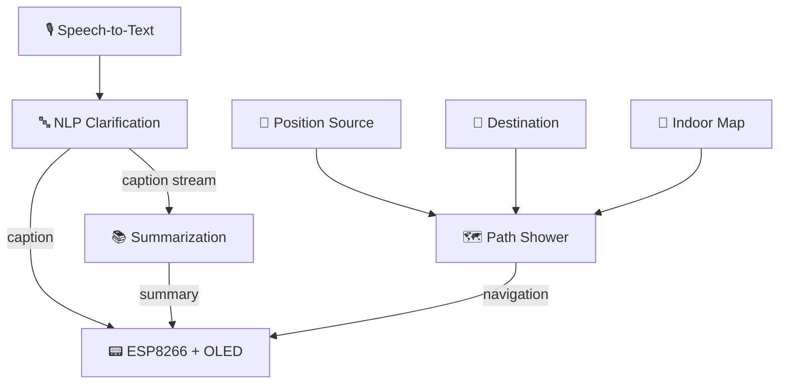

# 🥽 VoxLens

*Bridging the gap between people who can't hear and people who don't sign.* 🌉

VoxLens is an AI-powered smart-glasses system that turns spoken conversation into readable captions on a tiny OLED display. Deaf and hard-of-hearing people can follow what hearing people say without needing them to learn sign language. 👓💬

---

## 😟 The Problem

Most conversations happen in spoken language. A deaf or hard-of-hearing person who doesn't rely on lip-reading may miss much of what's said, and most hearing people don't know sign language. That leaves a gap: meetings, classes, shops, and everyday chats become hard to follow, and both sides end up frustrated. Indoor navigation adds another barrier, since most guidance relies on voice prompts or sound cues. 🧭

---

## 💡 The Solution

VoxLens listens to the conversation, cleans up the transcript, and shows it on the wearer's glasses, so the person can read along in real time. 📖

- 🗣️ **Clear captions:** Better punctuation, filler words removed, and speech-recognition mistakes corrected.
- 🎨 **Speaker colors:** Each speaker gets a distinct color, so it's clear who said what in a group.
- 📝 **Local summaries:** Key points and action items from longer conversations, generated on the device.
- 🧭 **Path Shower:** Turn-by-turn indoor directions shown as text. 🚶‍♀️
- 📟 **OLED display:** A compact SSD1306 screen driven by an ESP8266.

🔒 AI inference runs locally, so conversations never have to leave the device.

---

## 🏗️ Architecture

VoxLens is split into three layers that communicate through a shared JSON schema.

| Layer | Hardware / Tech | Responsibility |
|---|---|---|
| 🧠 **Intelligence** | Laptop / Raspberry Pi 5 / Jetson, Python | NLP clarification, summarization, path routing |
| 📡 **Transport** | Wi-Fi, JSON messages | Sends caption, summary, and navigation messages |
| 👁️ **Display** | ESP8266, SSD1306 OLED | Shows messages to the wearer |

### 🧩 Modules

| Module | Job | Powered by |
|---|---|---|
| 🔤 NLP Clarification | Tidies transcripts and tags speakers | T5-small |
| 📚 Summarization | Summarizes conversations, extracts key points | Gemma 2 2B (Ollama / llama.cpp) |
| 🗺️ Path Shower | Builds routes and turn-by-turn directions | Dijkstra / A* on an indoor graph |

### 📨 Message Types

| Type | Purpose |
|---|---|
| `caption` | Clarified speech with speaker info |
| `summary` | Summaries, key points, action items |
| `navigation` | Turn-by-turn instructions |

---

## 🔀 System Design



**How it flows:** 🔄

1. 🎙️ Speech-to-Text turns the conversation into a transcript upstream.
2. 🔤 NLP Clarification cleans it up and attaches the speaker's color.
3. 📚 Summarization runs over the caption stream and produces key points.
4. 🗺️ Path Shower works independently, turning position and destination into directions.
5. 📟 Every module sends JSON messages to the OLED.

---

## 📁 Project Structure

```text
voxlens/
├── schema/              # Shared JSON message definitions
├── nlp_clarification/
├── summarization/
├── path_shower/
├── common/              # Config, logging, message bus
├── tests/
├── data/                # Sample map and transcript
└── docs/
```

## 🚧 Known Limits

- 🧩 The 2B model can struggle with long conversations.
- 📍 Positioning is simulated for now (BLE, UWB, or vision needed for real use).
- 🌐 English only, for now.


---

**Built with ❤️ to close the communication gap.** 💜
