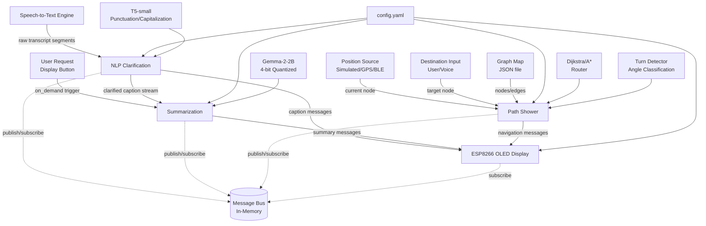

# VoxLens Architecture

## System Overview



## Module Details

### 1. NLP Clarification (`nlp_clarification/`)
- **Input**: Raw STT segments with speaker_id, speaker_name, colour, confidence, timestamps
- **Processing**:
  - Rule-based cleanup: filler removal, repeated words, ASR corrections, number/date normalization
  - T5-small: punctuation restoration and capitalization (with context window of 3 segments)
  - Allowlist protection for proper nouns
- **Output**: CaptionMessage with `text_original` and `text_clarified`
- **Latency**: <300ms per segment
- **Topics**: Subscribes to `voxlens.raw_transcript`, publishes to `voxlens.caption`

### 2. Summarization (`summarization/`)
- **Input**: Stream of CaptionMessage objects (rolling 15-min window)
- **Processing**:
  - TextChunker: splits into ~2000 token chunks with overlap
  - LLM (Gemma-2-2B via Ollama): summarizes each chunk
  - Merger: combines chunk summaries, deduplicates key points
  - JSON validation with 1 retry
- **Triggers**: Interval (5 min default) + On-demand
- **Output**: SummaryMessage with summary, key_points, action_items
- **Latency**: <20s for 10-min conversation
- **Topics**: Subscribes to `voxlens.caption`, `voxlens.summary_request`, publishes to `voxlens.summary`

### 3. Path Shower (`path_shower/`)
- **Input**: Current position node, destination node, graph map
- **Processing**:
  - Router: Dijkstra/A* on NavigationGraph
  - TurnDetector: computes heading changes, classifies as left/right/straight/u_turn/arrive
  - Recalculation: triggers when >5m off route or at unexpected node
- **Output**: NavigationMessage with instruction, distance_m, next_label
- **Latency**: <1s per cue
- **Topics**: Subscribes to `voxlens.position_update`, `voxlens.destination_set`, publishes to `voxlens.navigation`

## Data Flow

```
┌─────────────┐     ┌──────────────────┐     ┌─────────────────┐
│   STT       │────▶│  NLP Clarifier   │────▶│  Caption Msg    │
│  (external) │     │  (t5-small)      │     │  (validated)    │
└─────────────┘     └──────────────────┘     └────────┬────────┘
                                                      │
                        ┌─────────────────────────────┘
                        ▼
              ┌──────────────────┐     ┌─────────────────┐
              │  Summarizer      │────▶│  Summary Msg    │
              │  (Gemma-2B)      │     │  (validated)    │
              └──────────────────┘     └─────────────────┘
                        │
                        ▼
              ┌──────────────────┐
              │  Path Shower     │
              │  (Dijkstra +     │
              │   Turn Detector) │
              └────────┬─────────┘
                       │
                       ▼
              ┌──────────────────┐
              │  ESP8266 OLED    │
              │  (128x64, 20x4)  │
              └──────────────────┘
```

## Message Schema

All messages share:
```json
{
  "version": "1.0",
  "type": "caption|summary|navigation",
  "id": "uuid",
  "timestamp": "ISO8601 UTC"
}
```

### Caption
```json
{
  "text_original": "raw stt output",
  "text_clarified": "processed text",
  "speaker_id": "S1",
  "speaker_name": "Teacher",
  "colour": "FF6B6B",
  "confidence": 0.95,
  "start_ms": 1000,
  "end_ms": 2500
}
```

### Summary
```json
{
  "scope": "on_demand|interval",
  "window_start_ms": 0,
  "window_end_ms": 300000,
  "summary": "Discussion about VoxLens hardware...",
  "key_points": ["Teacher: ESP8266 display", "Student: Raspberry Pi 5"],
  "action_items": ["Bring glasses to class"]
}
```

### Navigation
```json
{
  "instruction": "left|right|straight|u_turn|arrive|recalculating",
  "distance_m": 10,
  "next_label": "Room 101"
}
```

## Configuration

All settings in `config.yaml`:
- Model paths and parameters
- Summary window/interval
- NLP lookback window
- Speaker palette (hex colours)
- Turn angle thresholds
- Map file path
- Logging settings

## Simulator Mode

Each module has a simulator for testing without hardware:
- `python -m nlp_clarification.simulator` - replays sample_transcript.json
- `python -m summarization.simulator --stub` - uses StubLLMClient
- `python -m path_shower.simulator` - walks sample_map.json

## Open Risks

1. **Summary quality on 2B model** - Gemma-2-2B may struggle with complex multi-speaker conversations; monitor quality and consider upgrading to 3B+ if needed
2. **Latency under load** - All three modules + STT running on 16GB RAM laptop; need profiling and optimization
3. **No real indoor positioning** - Simulator uses scripted positions; real deployment needs BLE/UWB/visual positioning integration
4. **Speaker diarization dependency** - Upstream system must provide speaker_id/name/colour reliably
5. **English only** - Language config placeholder exists but not implemented; T5 and Gemma are English-only
6. **T5 model download** - First run downloads ~60MB; need offline bundle for air-gapped deployments
7. **Ollama dependency** - Summarization requires Ollama running; need fallback or bundled llama.cpp